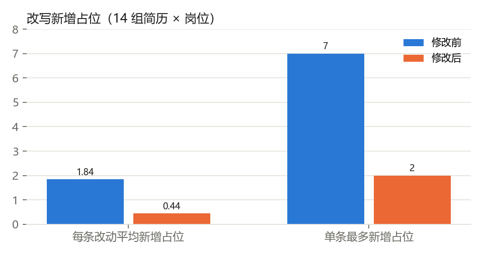
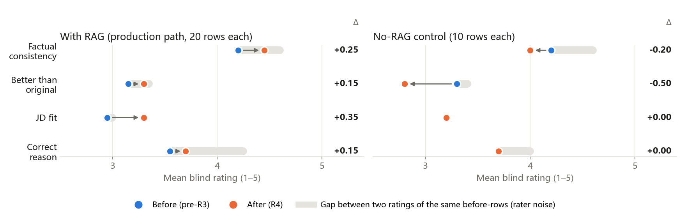
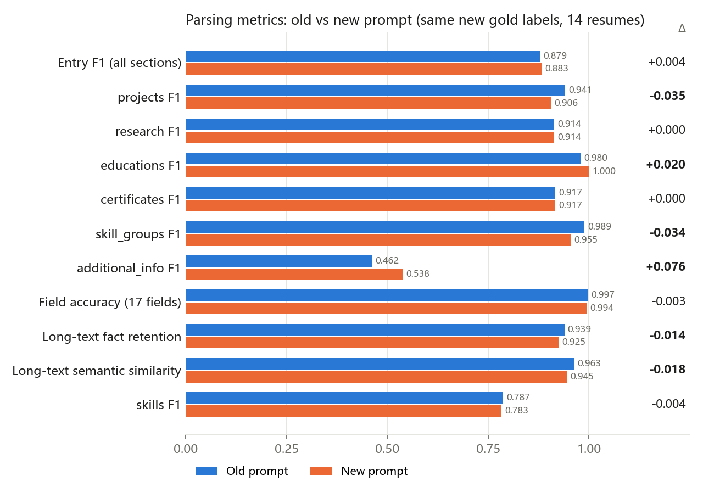
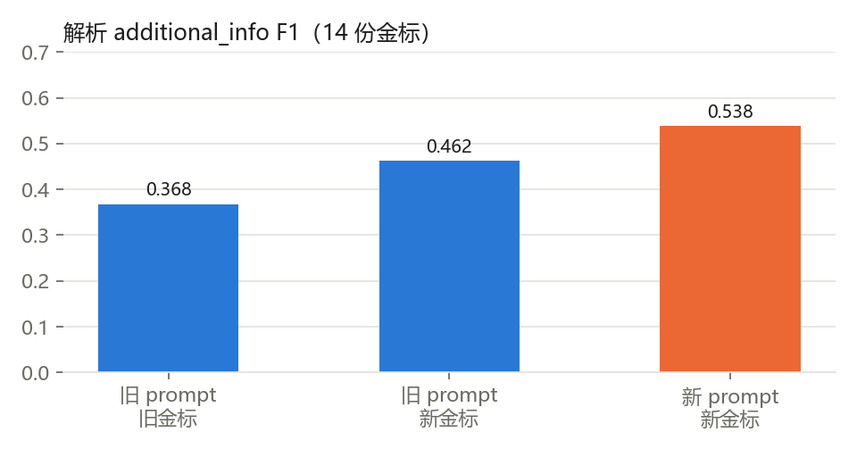

# Evaluation: Resume Parsing and Resume Rewriting

This document covers how we evaluated the two LLM modules in IT CareerPilot (resume parsing and resume rewriting), the four rounds of changes we made, and the numbers before and after each change.
Job ranking and recommendation were evaluated by a teammate; see `SystemCode/backend/evaluation/job_ranking/`.
The eligibility rule engine evaluation (`evaluate_rule_engine.py`) was briefly part of this work in round 1, then handed over to be evaluated together with ranking before round 3. It is out of scope here.

## 1. Evaluation Design

### 1.1 Why we replay cached answers instead of calling the LLM

The deployed system calls Gemini through an OpenAI-compatible API. The free tier allows about 20 calls a day, and a single evaluation round needs well over a hundred. The cloud development sessions also had no Gemini key.
So the LLM answers used in evaluation were produced by **haiku sub-agents** inside Claude Code sessions, and the scripts read them back through `ReplayClient` (`SystemCode/backend/scripts/eval_llm_cache.py`):

1. Run an evaluation script. Each LLM call is looked up by the hash of (system prompt, user prompt) in `eval_outputs/haiku/responses/<hash>.txt`. Prompts with no stored answer are written to `pending/`.
2. Each pending prompt is answered by its own haiku sub-agent, which reads only that one prompt file. (The gold labels live in the same repository, so reading anything else would leak the answers.)
3. Re-run the script. Cached answers flow through the real code path (validation, retry, follow-up calls) until nothing is pending.

Because `responses/` is committed, anyone who re-runs the scripts gets the same numbers without calling any LLM. The costs and limits:

- **The evaluated model is not the production model.** The numbers describe haiku under our system prompts. Switching to Gemini means re-running everything.
- **One sample per prompt.** Overall changes of a few tenths of a point up to two or three points cannot be separated from noise.
- **Any prompt change invalidates old answers.** After editing a prompt, a detector rule, retrieval, or JD data, the old answers no longer match and need to be regenerated.

### 1.2 What we measured

| ID | Module | What it measures | Data | Labels |
|---|---|---|---|---|
| P1 | Parsing | Against gold: item F1, field accuracy, fact retention and semantic similarity for long text | 14 test resumes (5 Chinese, 9 English, 4 of them for ML/algorithm roles) | Hand-built by Claude following the parsing rules (**silver labels**) |
| P2 | Parsing | Gold-free self-check: retention of numbers from the source, suspected invented numbers, email/link retention | Same | None needed |
| P3 | Parsing | Process: pass on first try / retry / failure | Same | None needed |
| W1 | Rewriting | Precision/recall/F1 of the rule-based line issue detector | dev 134 lines (seen while tuning rules) + heldout 77 lines | Rule-based manual labels (silver; spot check of 27 lines, κ = 0.956) |
| W2 | Rewriting | Knowledge-base retrieval hit@3 / MRR, issue coverage | 82 hand-written cases + 14 evaluation pairs | Hand-written |
| W3 | Rewriting | End to end: changes accepted/rejected, rationale citations, placeholders, line issue counts, JD alignment | 14 (resume × job) pairs; JD body ≥ 200 characters and lists responsibilities | None needed |
| W4 | Rewriting | Blind 1–5 rating on four dimensions: factual consistency, better than original, fits the JD, rationale correct | 30 lines sampled at random from W3 changes | sonnet sub-agents rating blind (group hidden) |
| W5 | Rewriting | Ablation: knowledge-base retrieval removed (no RAG), everything else unchanged | Same as W3 | Same as W3 |

How to run (from `SystemCode/backend/`; needs local PostgreSQL and the all-MiniLM-L6-v2 embedding model):

```bash
python -m scripts.evaluate_resume_parsing [-v]            # P1–P3
python -m scripts.evaluate_rewrite [-v] [--export]        # W1, W3, W5; --export writes the W4 rating sheet
python -m scripts.evaluate_rewrite --score                # averages a filled-in W4 rating sheet
python -m scripts.evaluate_guideline_retrieval            # W2
python -m scripts.prune_eval_cache [--apply]              # removes cached answers the current evaluation no longer uses
```

Reproduction note: W3 pairs refer to resume upload records in the database by id. Records 17–20 (the 4 ML/algorithm resumes) are not in the team database snapshot. On a fresh setup, first replay those 4 parses with `LLMResumeParser(client=ReplayClient())`, then write them back with `ResumeHistoryRepository.add`. Before writing, check that `resume_uploads_id_seq` has last_value 16.

## 2. Run Log (where each number comes from)

| Run | Date | Code / cache | Notes |
|---|---|---|---|
| R1 | Oct 14 | Intermediate, not kept | Round 1: 10 gold resumes, detector dev set |
| R2 | Oct 14 | Intermediate, not kept | Round 2: gold set grown to 14, heldout added, silver labels spot-checked, evaluation script fixed |
| R3-pre | Oct 14 | Intermediate, not kept | Baseline before round 3 fixes (after re-selecting pairs, before two production fixes); W4 rated once by sonnet |
| R3 | Oct 14 | Intermediate, not kept | After round 3: placeholder false rejection and detector false positives fixed |
| R4-pre | Oct 14 | Intermediate, not kept | Baseline before round 4 (the code after R3) |
| R4-pre-parse | Oct 16 | Extra run, not kept | Old parsing prompt (`550a0ce`) + old answers, re-scored on the new gold set; used only in 4.3 to separate the effect of the prompt from the effect of relabeling |
| R4 | Oct 14 | Code `7d0f1cd`, answers `54d6f7e` | Round 4 final: rewrite prompt constraints + new parsing prompt + additional_info relabeled |
| W4-mixed | Oct 14 | `w4_mixed_sheet.csv` / `w4_mixed_key.json` (`54d6f7e`) | The 30 W4 rows from R3-pre and the 30 from R4, mixed and re-rated blind by the same set of raters |

R1 through R4-pre-parse were intermediate states in local sessions. Their code and answers were not kept, so those numbers can only be cited from this document and cannot be reproduced.
The repository holds only the 68 answers that R4 actually uses. Re-running the scripts in `SystemCode/backend/` gives the R4 numbers in Section 4.
**Re-run on `065fac6`, the last commit of the evaluation branch** (`git switch --detach 065fac6`). After the merge into main, a teammate changed responsibility and skill scoring (`responsibility_scorer`, `skill_scorer`, `jd_alignments`). That changes the rewrite prompts sent to the LLM, so running the rewrite evaluation on main leaves 22 prompts pending (checked Oct 16). The parsing evaluation is not affected.

## 3. Optimisation Process

Every round followed the same loop: run a baseline and record the numbers, change one thing, re-run and compare. Changes that did not show an improvement were reverted.

### Round 1 (R1): PDF extraction and detector regexes

| Problem | Change | Before → after |
|---|---|---|
| In two-column resumes, pdfminer attached dates to the wrong entry | Added `pdf_text` for layout-aware extraction | Misplaced dates 4 → 0 |
| Detector missed buzzwords and missing outcomes | Added regexes | W1 dev F1: buzzword 0 → 1.0, missing_outcome 0.74 → 0.83 |

### Round 2 (R2): more data, and fixing the evaluation itself

- Gold set grown from 10 to 14 resumes (4 English ML resumes with papers, patents and research). W1 split off a heldout set of 77 lines.
- **A bug in the evaluation script**: entries with empty titles were paired at random, so research.type showed 2/4 correct. After the fix it was actually 16/16. The "parsing errors" we had been looking at were an artefact of the evaluation.
- We tried two versions of a parsing prompt rule for separating research from projects. The target error count stayed at 3. The first version also moved whole internships into projects (fact retention 0.939 → 0.901). **Reverted.**

### Round 3 (R3): running locally end to end, plus two production fixes

- Evaluation pairs re-selected: in 9 of the old 10 pairs, the JD had only a title and no responsibilities, so "fits the JD" could not be judged. We re-selected 14 pairs using "highest ranked, JD body ≥ 200 characters, has responsibilities".
- Fixed `rewrite_applier.check_facts`: placeholder text in `[...]` is now stripped before checking for new skills. Before, `[database load change]` was rejected as introducing the new skill "databases".
- Fixed detector false positives: skip `Keywords:` lines, author lines and venue-ranking lines of ≤ 15 words, and topic-tag lines in research blocks. (On Oct 16 the topic-tag rule was narrowed to research blocks only. Short comma-separated bullets in experience/project blocks, such as "Built REST APIs, wrote unit tests, deployed services", had also been skipped as tag lines.)

| Metric | Before | After |
|---|---|---|
| W1 heldout missing_outcome P | 0.258 | 0.500 |
| W1 heldout missing_quantification P | 0.724 | 1.000 |
| W3 with RAG, changes accepted / rejected | 53 / 1 | 55 / 1 |
| W3 without RAG, changes accepted / rejected | 34 / 0 | 38 / 0 |

Note: the heldout set was used to tune rules in this round, so **from here on it is no longer held out**. Round 4 heldout numbers should be read as a second dev set.

### Round 4 (R4): rewrite prompt constraints + parsing additional_info

The round 3 W4 blind rating surfaced three rewriting problems: too many placeholders (up to 7 in one change, leaving the user a long list of data to fill in), rationales describing edits that were never made, and the skills section losing proficiency words like "familiar" or "proficient". On the parsing side, additional_info F1 was only 0.368.

Rewriting (`app/resume/resume_rewriter.py`):

- At most 2 new placeholders per change (`MAX_NEW_PLACEHOLDERS`). A rationale may only describe edits actually made between the original and the rewrite. Experience/project/research blocks are rewritten toward the aligned JD responsibilities. The skills section keeps proficiency wording.
- New soft check `change_problems`: on a violation (too many placeholders, or a rationale naming a skill found in neither the original, the rewrite nor the JD), the call is retried once with the problems listed. If it still fails, the output is used anyway, so one bad change never fails the whole rewrite.

Parsing (`app/resume/llm_resume_parser.py`):

- Rule 5 now reads "each fact goes in one place: facts with a dedicated field go there (career intent → about, GPA → education, test scores → certificates, ...), and only the rest goes into additional_info".
- additional_info gold labels were redone blind under the same rule. Matching now also compares the value after the colon, since labels are free text and the same fact can be worded differently.

## 4. Results Before and After

### 4.1 Resume rewriting (W3 / W5, 14 pairs)



| Metric | R4-pre with RAG | R4 with RAG | R4 without RAG |
|---|---|---|---|
| Mean new placeholders per change (max) | 1.84 (7) | **0.44 (2)** | 0.43 (2) |
| Changes over the placeholder limit | 16 | **0** | 0 |
| Changes accepted / rejected | 55 / 1 | 41 / 1 | 28 / 0 |
| Rationales / rationales with no citation | — | 114 / 3 (0.026) | 79 / 79 (1.000) |
| Rationales naming a skill absent from original, rewrite and JD | — | 0 | 1 |
| Rationales tagged with an aligned JD responsibility | — | 58 / 114 | 23 / 79 |
| Mean Δ similarity between rewritten block and aligned responsibility | — | +0.024 (13 blocks) | +0.029 (8 blocks) |
| Line issues before → after | — | 34 → 25 | 32 → 30 |
| Mean Δ responsibility fit score (out of 30) | — | +0.13 | +0.22 |
| Mean Δ skill score (out of 65) | — | +0.00 | +0.00 |

"—" marks metrics added in round 4 that were not measured before. The R4-pre placeholder numbers were computed on the old answers after the placeholder metric was added. How to read the table:

- **The placeholder problem is fixed.** Changes over the limit went from 16 to 0, and the mean dropped to a quarter. The limit itself was added this round, so "0 over the limit" only shows the constraint works. It says nothing about rewrite quality; see the blind rating in 4.2 for that.
- **Rewriting barely moves the match score.** The responsibility fit score rises by 0.13 / 30 on average and the skill score does not change. This is expected: new skills and new numbers are not allowed, so only wording and order can change. The value of rewriting has to be judged by the blind rating and the line issue counts, not described as "improving the match".
- **Fewer changes are accepted** (55 → 41). Some blocks that were previously "rewritten" by piling on placeholders are now left alone. The W4 blind rating (4.2) shows this did not cost quality.
- **Rejected changes.** The single rejected change in R3-pre (CI/CD) was judged a false rejection in the W4 rating. The single rejected change in R4 (new_skill: machine learning) is listed in `eval_outputs/haiku/rejected_changes_review.csv`; we have not decided whether it was a real invention or a false rejection.
- **RAG mainly helps explainability.** With RAG, 97% of rationales cite a knowledge-base entry. Without RAG the figure is 0% by construction (there is nothing to cite), so that is not an effect of RAG. The quality difference between the two groups is within noise (both the round 3 and round 4 ratings agree), and we have no evidence that RAG improves rewrite quality.
- **Missing-number and missing-outcome issues barely drop** (missing_quantification 10 → 9, missing_outcome 13 → 14). This is by design: numbers not in the original may not be invented, so the rewriter leaves placeholders for the user. The counts only fall once the user fills them in.

### 4.2 W4 mixed blind rating

The R3-pre (before round 3 fixes) and R4 rating sheets, 30 rows each, were combined into 60 rows, shuffled and renumbered M01–M60, with the group mapping stored in a separate key file.
4 sonnet sub-agents rated 15 rows each without knowing which rows came from before or after.
The "before → after" here therefore combines round 3 (placeholder false rejection, detector false positives) and round 4 (prompt constraints).
"Before" in this section always means R3-pre.



Reading the figure: blue dot → orange dot is before → after, with the difference on the right. The grey bar is the gap between two ratings of the same "before" rows (round 3 vs. this round), i.e. the size of rater noise. Grey bars range from 0.05 to 0.70 across dimensions. Only two arrows exceed their own dimension's grey bar: "fits the JD" with RAG (+0.35) and "better than original" without RAG (−0.50). Both are still smaller than the 0.4–0.7 noise on the other dimensions, so neither counts as significant.

| Group | Rows | Factual consistency | Better than original | Fits the JD | Rationale correct |
|---|---|---|---|---|---|
| R3-pre · with RAG | 20 | 4.20 | 3.15 | 2.95 | 3.55 |
| **R4 · with RAG** | 20 | **4.45** | **3.30** | **3.30** | **3.70** |
| R3-pre · without RAG | 10 | 4.20 | 3.30 | 3.20 | 3.70 |
| R4 · without RAG | 10 | 4.00 | 2.80 | 3.20 | 3.70 |

- With RAG (the production path), all four dimensions rise slightly, and "fits the JD" rises most (+0.35). This matches the round 4 prompt change to rewrite toward the aligned responsibilities.
- **Design limits.** Each row has one rater, and the 4 raters each saw different rows, so rater differences and row differences are mixed together. The before and after rows are separate samples of changes, not paired comparisons of the same blocks.
- **The effect is within rater noise.** The same 30 R3-pre rows were rated by sonnet once in round 3 (with RAG: factual 4.60 / rationale 4.25) and scored 4.20 / 3.55 this time. Two ratings of the same rows differ by 0.4–0.7, more than the before/after gap. The only safe conclusion is "no regression, trending better".
- Every row marked down for "too many placeholders to be usable" (M05, M19, M28; M28 had 6 placeholders) is from before.
- "Better than original" without RAG fell from 3.30 to 2.80. That group has only 10 rows and is the control; production does not use this path.
- The remaining low scores fall into two groups, neither caused by the rewriter itself. (1) Skills sections judged as "adding skills out of nowhere" (M01, M12, M59): the rater only sees that one block, so skills moved from elsewhere in the same resume look invented. `check_facts` compares against the whole resume and accepts them. (2) Low "fits the JD" (M02, M26, M40): quantitative trading roles paired with remote sensing or diffusion-model research, where the job and the resume simply do not match.

### 4.3 Resume parsing (P1–P3, 14 resumes)

Round 4 changed both the prompt and the gold labels. To separate the two, we compare R4-pre-parse (old prompt + old answers, re-scored on the **new gold set**) with R4. Both use the same gold set, so any difference comes from the prompt alone.



| Metric | R3 (old prompt, old gold) | R4-pre-parse (old prompt, new gold) | R4 (new prompt, new gold) | Δ (prompt only) |
|---|---|---|---|---|
| Item F1 (all sections) | 0.864 | 0.879 | 0.883 | +0.004 |
| projects F1 | — | 0.941 | 0.906 | −0.035 |
| educations F1 | — | 0.980 | 1.000 | +0.020 |
| skill_groups F1 | — | 0.989 | 0.955 | −0.034 |
| additional_info F1 | 0.368 | 0.462 | **0.538** | **+0.076** |
| Field accuracy (17 fields) | 0.991 | 0.997 | 0.994 | −0.003 |
| Long-text fact retention | — | 0.939 | 0.925 | −0.014 |
| Long-text semantic similarity | 0.963 | 0.963 | 0.945 | −0.018 |
| skills F1 | — | 0.787 | 0.783 | −0.004 |
| Source number retention | — | 429 / 438 | 429 / 438 = 0.979 | 0 |
| Suspected invented numbers | — | 2 / 325 | 2 / 325 = 0.006 | 0 |
| P3 first pass / retry / failure | — | 14 / 0 / 0 | 14 / 0 / 0 | — |

F1 for experiences, research, certificates and awards, and accuracy for name / email / phone, are identical in both versions (research 0.914, certificates 0.917, all others 1.000). The figure only shows research and certificates.



- **The new prompt only helps the field it targeted.** additional_info gains +0.076, since career intent, department names, GitHub links and similar items are no longer duplicated into it. Of the full 0.368 → 0.538 gain, the other 0.094 comes from relabeling.
- **Other metrics drop slightly**: projects −0.035, skill_groups −0.034, fact retention −0.014, semantic similarity −0.018; within field accuracy, certificates.score went from 11/11 to 9/11. Of the overall item F1 gain (0.864 → 0.883), 0.015 comes from relabeling and only +0.004 from the prompt.
  A likely cause is that "each fact in one place" led the model to move some content out of projects and skills; we did not check this item by item. With one sample per resume, these differences may also be noise. **Conclusion: for parsing overall, this prompt change is neutral. It should not be reported as an improvement.**
- additional_info is a catch-all field that is not used for matching or rewriting, so its 0.538 has limited impact.
- R4-pre-parse was an extra run on Oct 16 (parsing prompt from `550a0ce`, answers from the cache before pruning). The answers it used were not kept.

### 4.4 Issue detector (W1) and retrieval (W2)

| Issue type | dev F1 | heldout F1 (already used for tuning) |
|---|---|---|
| weak_action_verb | 1.000 | 0.889 |
| passive_voice | 0.929 | 1.000 |
| buzzword | 1.000 | 0.900 |
| missing_quantification | 0.886 | 0.894 |
| missing_outcome | 0.827 | 0.571 (P 0.471) |

On Oct 16 the topic-tag rule was narrowed to research blocks (W1 cases gained a `section` field from their source). heldout missing_quantification went from 0.913 to 0.894 and missing_outcome from 0.593 to 0.571, both because of a single project-block line, "LLM systems, intelligent Q&A", which is now checked. This is a deliberate trade: one more false positive in exchange for no longer missing short bullets in experience and project blocks. dev and W3 numbers are unchanged.

W2 retrieval (R3; retrieval was not changed in round 4): over 82 cases, hit@3 0.927 / MRR 0.846. Issue coverage across the 14 evaluation pairs is 202 / 202.

## 5. Limitations

1. **Gold labels and ratings come from models.** The parsing gold set is a silver set built by Claude, and W4 was rated blind by sonnet sub-agents. The detector spot-check κ = 0.956 measures agreement between a Claude labeler and another Claude sub-agent, not between a human and a model. No human ratings were collected.
2. **Answers and ratings come from the same model family.** Answers are from haiku; gold labels and ratings are from Claude / sonnet. Same-family self-preference may push blind scores up.
3. **The evaluated model is not the production model.** Answers come from haiku, while production uses Gemini. The fixes have not been re-tested on Gemini.
4. **Small samples, one sample per prompt.** 14 resumes, 14 evaluation pairs, 10–20 rated rows per W4 group. Blind-rating differences under about 0.4 cannot be told apart from noise.
5. **The detector has no true held-out set.** heldout was used to tune rules in round 3. Reporting generalisation would need new resumes labeled blind.
6. **Some evaluation pairs are mismatched.** Jobs were picked from ranking results, and some do not fit the resume's direction, which pulls "fits the JD" down.

## 6. Files

| Path | Contents |
|---|---|
| `SystemCode/backend/scripts/evaluate_resume_parsing.py` | P1–P3 |
| `SystemCode/backend/scripts/evaluate_rewrite.py` | W1, W3, W5, W4 export and scoring |
| `SystemCode/backend/scripts/evaluate_guideline_retrieval.py` | W2 |
| `SystemCode/backend/scripts/eval_llm_cache.py` / `prune_eval_cache.py` | Replay cache / pruning unused answers |
| `SystemCode/backend/resume test/parsed/` | 14 parsing gold files |
| `SystemCode/backend/scripts/issue_detector_cases.json` | W1 labels (dev / heldout) |
| `SystemCode/backend/scripts/rewrite_eval_pairs.json` | The 14 W3 evaluation pairs |
| `SystemCode/backend/eval_outputs/haiku/` | Answer cache, W4 rating sheets, rejected-change review sheet |
| `SystemCode/evaluation/figures/` | Figures used in this document |
